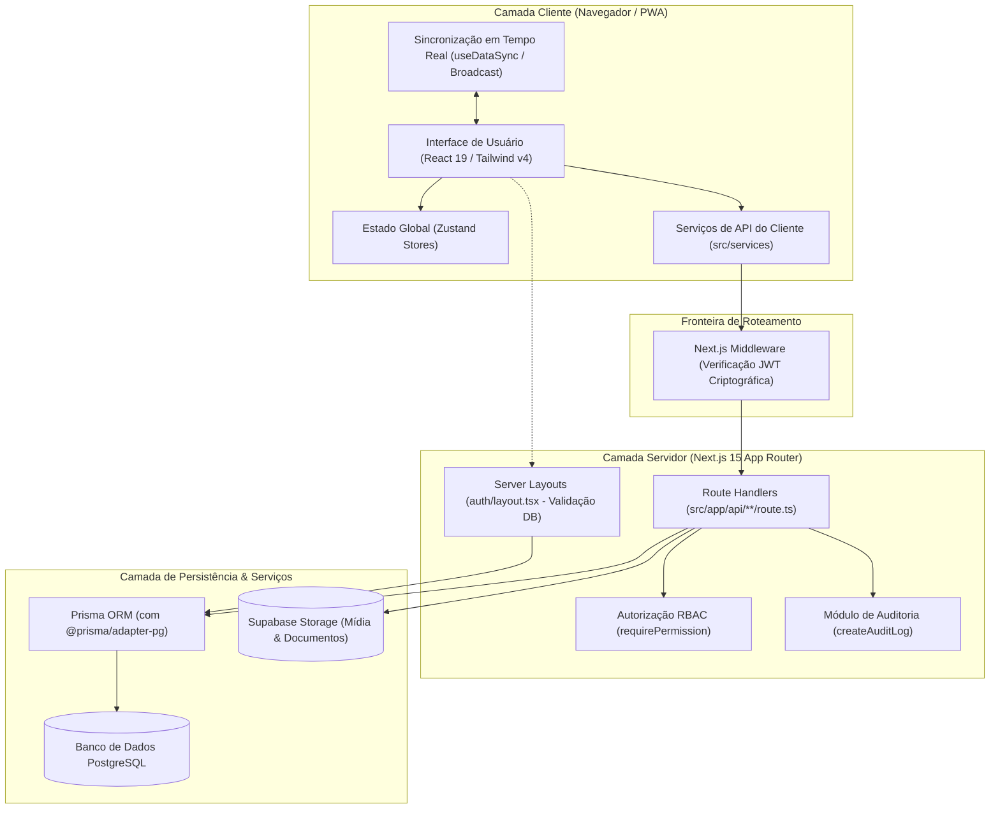
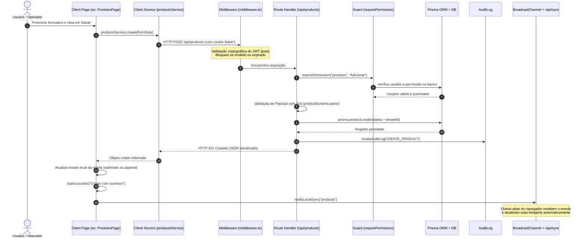

# 01. Macroarquitetura, Camadas e Next.js App Router

Este documento detalha a arquitetura geral da aplicação, a separação de responsabilidades em camadas, o fluxo de dados de ponta a ponta e a estratégia de divisão entre Server Components e Client Components no Next.js 15 (App Router).

---

## 1. Visão Geral da Arquitetura

A aplicação opera sob um modelo **Fullstack Monolítico Modular** construído com **Next.js 15 (App Router)** e **React 19**, executando em ambiente Node.js e empacotado como **Progressive Web App (PWA)** instalável.

### Diagrama Arquitetural de Camadas

---

## 2. Camadas da Aplicação e Responsabilidades

O sistema é estritamente particionado nas seguintes camadas de responsabilidade:

### 1. Camada de Apresentação (UI / Components / Pages)
- **Localização:** `src/app/(auth)/**/page.tsx`, `src/components/**`
- **Responsabilidade:** Renderização da interface visual, captura de interações do usuário, disparo de ações e exibição de feedback (toasts, dialogs, drawers).
- **Classificação:** `[PADRÃO EXISTENTE]` - Quase a totalidade das páginas operacionais sob `(auth)` são Client Components (`"use client"`), maximizando a interatividade de tela e a velocidade de resposta sem reloads.

### 2. Camada de Comunicação Client-side (Services)
- **Localização:** `src/services/*.service.ts`
- **Responsabilidade:** Abstração completa de chamadas HTTP via `fetch` tipado (`apiRequest<T>`). As páginas nunca fazem chamadas diretas com strings literais de URL.
- **Classificação:** `[PADRÃO EXISTENTE]` - Centraliza rotas como `productsService.list()`, `salesService.create()`, convertendo respostas e erros do servidor em exceções descritivas.

### 3. Camada de Roteamento e Interceptação (Middleware)
- **Localização:** `middleware.ts` na raiz
- **Responsabilidade:** Guarda defensiva e controle de rotas público/privado. Validação exclusivamente criptográfica do token JWT (sem consultas lentas a banco de dados).
- **Classificação:** `[PADRÃO EXISTENTE]` - Redireciona usuários deslogados para `/login`, usuários sem onboarding concluído para `/onboarding` e barra acessos sem token antes que a requisição atinja os Handlers de API.

### 4. Camada de Controle e APIs do Servidor (Route Handlers)
- **Localização:** `src/app/api/**/route.ts`
- **Responsabilidade:** Endpoints REST que processam requisições HTTP, validam permissões com granularidade RBAC, validam payloads com Zod, operam transações e retornam payloads JSON serializados.
- **Classificação:** `[PADRÃO EXISTENTE]`.

### 5. Camada de Autorização e Auditoria
- **Localização:** `src/lib/require-permission.ts`, `src/lib/audit.ts`
- **Responsabilidade:** Verificação mandatória de permissões (`module` + `action`) com consulta de integridade ao banco de dados e gravação de histórico de auditoria (`AuditLog`).
- **Classificação:** `[PADRÃO EXISTENTE]`.

### 6. Camada de Acesso a Dados e Persistência (ORM)
- **Localização:** `src/lib/prisma.ts`, `prisma/schema.prisma`
- **Responsabilidade:** Singleton do Prisma Client configurado com adapter nativo PostgreSQL (`@prisma/adapter-pg`) e connection pooling via `pg.Pool`.
- **Classificação:** `[PADRÃO EXISTENTE]`.

---

## 3. Server Components vs. Client Components: Critérios de Decisão

A aplicação adota um padrão híbrido bem delimitado:

### Onde e Por Que Utilizar Server Components
Os Server Components são utilizados prioritariamente na infraestrutura de roteamento e layouts raiz:
- **`src/app/layout.tsx` (RootLayout):** Configura metadados SEO/PWA, fontes do Google com variáveis CSS (`Outfit`, `Noto_Sans`, `Montserrat`), provedores universais (`ThemeProvider`, `TooltipProvider`) e utilitários globais (`PWAUpdater`, `ThemeColorUpdater`, `ScrollToTop`).
- **`src/app/(auth)/layout.tsx` (AuthLayout):**
  - Executa no servidor (`async function AuthLayout`).
  - Realiza verificação profunda de sessão no banco (`getCurrentUser()`), impedindo acesso caso o usuário ou tenant tenha sido desativado em tempo real.
  - Lê cookies criptografados no servidor e extrai o contexto do usuário (`user_context`).
  - Injeta o contexto inicial no `PermissionsProviderWrapper` via propriedade `initialContext`, **eliminando completamente qualquer piscamento (flash) de layout ou autorização no carregamento inicial da página**.

### Onde e Por Que Utilizar Client Components
Os Client Components (`"use client"`) são empregados em:
- **Telas operacionais:** Todas as páginas com tabelas (`ProductsDataTable`), formulários modais, cálculos em tempo real (carrinho de PDV), leitores de código de barras por câmera (`html5-qrcode`) e filtros interativos.
- **Hooks de sincronização e estado:** `useDataSync`, `useCartStore`, `useSettingsStore`.
- **Modais e Drawers:** Componentes que exigem detecção de viewport (`useIsMobile`) e controle de ciclo de vida de animação.

### Tabela de Decisão para Novos Projetos

| Cenário de Aplicação | Componente Indicado | Justificativa Técnica |
| :--- | :---: | :--- |
| Validação de sessão, RBAC inicial e injeção de layouts | **Server Component** | Garante segurança antes da renderização e entrega HTML hidratado sem requisições client-side adicionais. |
| Páginas de listagem com busca dinâmica, paginação e filtros | **Client Component** | Resposta instantânea, gerenciamento de filtros em memória e escuta de eventos de sincronização multi-abas. |
| Formulários com máscaras, validações interativas e uploads | **Client Component** | Necessidade de controle de estado (`useState`), eventos de teclado e manipulação de arquivos no DOM. |
| Telas institucionais, termos de uso e documentação pública | **Server Component** | Zero JavaScript desnecessário entregue ao cliente, otimização de SEO e First Contentful Paint imediato. |

---

## 4. Fluxo de Dados End-to-End

O ciclo completo de uma operação típica (ex.: criação de um registro) opera da seguinte maneira:

---

## 5. Análise de Fidelidade: Padrões Existentes vs. Recomendações

### Padrão Existente no Zelo `[PADRÃO EXISTENTE]`
- Arquitetura baseada em **Route Handlers REST** (`/api/**`) consumidos por uma camada de serviços client-side (`src/services/`).
- Não utiliza Next.js Server Actions para mutações operacionais. Isso desacopla totalmente o backend HTTP do frontend, facilitando testes com Vitest, permitindo múltiplos clientes (PWA, mobile, integrações externas) e viabilizando o controle rígido de status HTTP (200, 201, 400, 401, 403, 404, 500).

### Inconsistência Identificada `[PARCIALMENTE ADOTADO]`
- Páginas operacionais realizam fetch manual via `useEffect` no carregamento da tela (`setLoading(true); service.list().then(...)`), em vez de aproveitar o SSR do Server Component pai para entregar os dados iniciais pré-carregados.

### Recomendação para Novos Projetos `[RECOMENDAÇÃO FUTURA]`
- Em novas aplicações com Next.js 15+, adotar um padrão híbrido refinado: o **Server Component da página busca os dados iniciais do banco via Prisma** e os repassa como `initialData` para o Client Component (tabela/listagem). O Client Component assume a interatividade a partir desse ponto, eliminando loaders em branco na primeira abertura.
