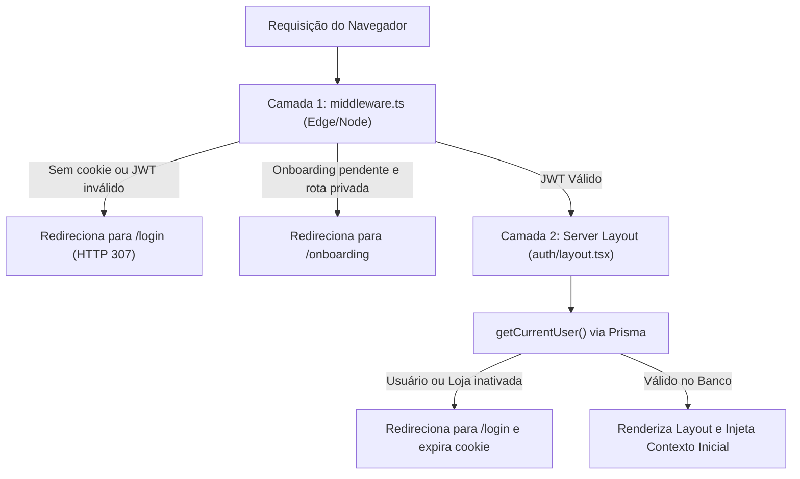

# 03. Páginas, Layouts, Rotas e Navegação

Este documento estabelece as convenções de roteamento, a arquitetura de layouts compartilhados, o mecanismo de proteção em duas etapas e as diretrizes passo a passo para a criação de novas páginas no Next.js 15 (App Router).

---

## 1. Organização das Rotas e Route Groups

O projeto utiliza **Route Groups** (pastas entre parênteses) para organizar contextos de segurança e layouts sem alterar os caminhos de URL visíveis para o usuário.

```text
src/app/
├── (admin)/                # Layout com sidebar administrativa
│   └── admin/
│       ├── dashboard/      # URL: /admin/dashboard
│       └── contas/         # URL: /admin/contas
├── (auth)/                 # Layout principal com Sidebar Desktop e Bottom Nav Mobile
│   ├── dashboard/          # URL: /dashboard
│   ├── produtos/           # URL: /produtos
│   ├── clientes/           # URL: /clientes
│   ├── historico/          # URL: /historico
│   ├── configuracoes/      # URL: /configuracoes
│   └── layout.tsx          # Layout privado unificado
├── cadastro/page.tsx       # URL: /cadastro (Pública)
├── login/page.tsx          # URL: /login (Pública)
├── onboarding/page.tsx     # URL: /onboarding (Protegida - assistente inicial)
└── layout.tsx              # Root Layout global
```

### Convenções de Nomenclatura de URLs
- **Rotas em português e kebab-case:** URLs públicas e privadas utilizam substantivos em português separados por hífen (ex.: `/nova-venda`, `/produtos-globais`, `/configuracoes`).
- **Rotas de APIs em inglês e kebab-case:** Os endpoints HTTP seguem o padrão REST em inglês (ex.: `/api/products`, `/api/stock-movements`, `/api/access-groups`).

---

## 2. A Estratégia de Proteção em Dupla Camada

A segurança das páginas não depende de um único ponto de falha. O Zelo adota uma **proteção defensiva em duas camadas**:



### Camada 1: Interceptação Rápida no `middleware.ts`
- **Execução:** Antes da renderização de qualquer rota.
- **Mecanismo:** Verifica criptograficamente a assinatura do cookie `token` usando `jose` (`jwtVerify`), sem tocar no banco de dados.
- **Função:** Redirecionamento instantâneo de visitantes deslogados para `/login` e de usuários recém-cadastrados para `/onboarding`.

### Camada 2: Validação de Integridade no `(auth)/layout.tsx`
- **Execução:** Server Component executado no servidor Node.js.
- **Mecanismo:** Executa `getCurrentUser()`, que consulta o banco via Prisma.
- **Função:**
  - Se a conta do usuário ou a loja tiver sido desativada em tempo real por um administrador, a sessão é revogada na hora.
  - Extrai o cookie `user_context` (Base64) e o injeta no `PermissionsProviderWrapper` via prop `initialContext`.
  - **Benefício:** Elimina completamente o atraso de verificação de permissões no cliente, garantindo que botões e itens de menu surjam no estado final correto sem "piscar".

---

## 3. Arquitetura de Layouts Híbridos (Desktop vs. Mobile)

Para entregar a melhor ergonomia tanto em monitores de alta resolução quanto em smartphones, o `(auth)/layout.tsx` implementa um padrão híbrido:

### No Desktop (`>= 768px`)
- Utiliza o componente `AppSidebar` baseado em `SidebarProvider` e `SidebarInset`.
- Cabeçalho superior fixo (`SiteHeader`) com breadcrumbs, botão de alternância de tema e perfil do usuário.
- O rodapé é limpo (`md:pb-6`).

### No Mobile (`< 768px`)
- A sidebar desktop é recolhida.
- A navegação primária é realizada pela barra inferior fixa (`BottomNavigation`), com 4 a 5 atalhos principais com ícones Boxicons e alvos de toque generosos (mínimo 44x44px).
- **Regra Sistêmica de Compensação:** O container de conteúdo principal DEVE possuir a classe `pb-24` no mobile para que o último elemento da página não fique oculto atrás da `BottomNavigation`.

```tsx
// Exemplo real de src/app/(auth)/layout.tsx
<SidebarProvider defaultOpen={false}>
  <AppSidebar variant="inset" />
  <SidebarInset>
    <SiteHeader />
    <div className="flex flex-1 flex-col pb-24 md:pb-6">
      <div className="@container/main flex flex-1 flex-col gap-2">
        <div className="flex flex-col gap-4 py-4 md:gap-6 md:py-6">
          {children}
        </div>
      </div>
    </div>
    <BottomNavigation />
  </SidebarInset>
</SidebarProvider>
```

---

## 4. Gestão de Estados de Tela: Carregamento, Erro e Vazio

Toda página deve contemplar de forma explícita os três estados essenciais de ciclo de vida:

### 1. Estado de Carregamento (Loading)
- Utiliza `<GlobalLoader />` (spinner centralizado com mensagem descritiva) ou `<Skeleton />` estrutural que espelha as linhas da tabela.

### 2. Estado de Erro (Error)
- Erros de rede ou permissão disparam `toast.error(mensagem)` via `sonner`.
- Em falhas críticas de autenticação (HTTP 401), a aplicação invoca `/api/auth/logout` e força `window.location.href = "/login"`.

### 3. Estado de Lista Vazia (Empty State)
- Quando a busca não encontra registros ou o banco está vazio, a tabela exibe um card acolhedor com ícone Boxicon em tamanho grande, título em negrito, frase de orientação e botão de ação direta (ex.: "Cadastrar Primeiro Item").

---

## 5. Passo a Passo: Como Criar uma Nova Página Seguindo o Padrão

Para adicionar um novo módulo ao sistema (ex.: `/tarefas`):

### Passo 1: Criar a Pasta e o Arquivo da Rota
Crie o arquivo em `src/app/(auth)/tarefas/page.tsx`:

```tsx
"use client";

import { useEffect, useState } from "react";
import { usePermissions } from "@/components/auth/permissions-provider";
import { useDataSync, notifyLocalSync } from "@/hooks/use-data-sync";
import { tasksService } from "@/services/tasks.service";
import { TasksDataTable } from "./data-table";
import { TaskForm } from "@/components/tasks/task-form";
import { GlobalLoader } from "@/components/ui/global-loader";
import { MobileActionFab } from "@/components/ui/mobile-action-fab";
import { toast } from "sonner";

export default function TarefasPage() {
  const { can } = usePermissions();
  const [tasks, setTasks] = useState<any[]>([]);
  const [loading, setLoading] = useState(true);
  const [isFormOpen, setIsFormOpen] = useState(false);
  const [editingTask, setEditingTask] = useState<any | null>(null);

  const fetchTasks = async () => {
    try {
      setLoading(true);
      const data = await tasksService.list();
      setTasks(data);
    } catch (err: any) {
      toast.error(err.message || "Erro ao carregar tarefas.");
    } finally {
      setLoading(false);
    }
  };

  useEffect(() => {
    fetchTasks();
  }, []);

  // Escuta alterações de outras abas ou dispositivos em tempo real
  useDataSync({
    types: ["tasks" as any],
    onSync: () => fetchTasks(),
  });

  if (loading) {
    return <GlobalLoader text="Carregando tarefas..." />;
  }

  return (
    <div className="space-y-6">
      <TasksDataTable
        data={tasks}
        canCreate={can("tarefas" as any, "Adicionar")}
        onCreateClick={() => {
          setEditingTask(null);
          setIsFormOpen(true);
        }}
        onEdit={(task) => {
          setEditingTask(task);
          setIsFormOpen(true);
        }}
      />

      {/* FAB Flutuante no Mobile */}
      {can("tarefas" as any, "Adicionar") && (
        <MobileActionFab
          icon="plus"
          label="Nova Tarefa"
          onClick={() => {
            setEditingTask(null);
            setIsFormOpen(true);
          }}
        />
      )}

      {/* Formulário Polimórfico (Drawer mobile / Dialog desktop) */}
      <TaskForm
        open={isFormOpen}
        onOpenChange={setIsFormOpen}
        initialData={editingTask}
        onSubmit={async (values) => {
          if (editingTask) {
            await tasksService.update(editingTask.id, values);
            toast.success("Tarefa atualizada com sucesso!");
          } else {
            await tasksService.create(values);
            toast.success("Tarefa criada com sucesso!");
          }
          notifyLocalSync("tasks" as any);
          fetchTasks();
          setIsFormOpen(false);
        }}
      />
    </div>
  );
}
```

---

## 6. Auditoria de Fidelidade

- **Padrão Existente `[PADRÃO EXISTENTE]`:** Uso de Route Groups `(auth)` com layout híbrido, verificação dupla com JWT em `middleware.ts` e Prisma em `(auth)/layout.tsx`, injeção do `user_context` para hidratação sem flash.
- **Inconsistência `[PARCIALMENTE ADOTADO]`:** Algumas rotas de administração usam convenções de formulário diferentes das rotas principais de lojista.
- **Recomendação Futura `[RECOMENDAÇÃO FUTURA]`:** Utilizar `loading.tsx` e `error.tsx` nativos do App Router em cada pasta de rota para Suspense Boundaries automáticos no nível de framework.
