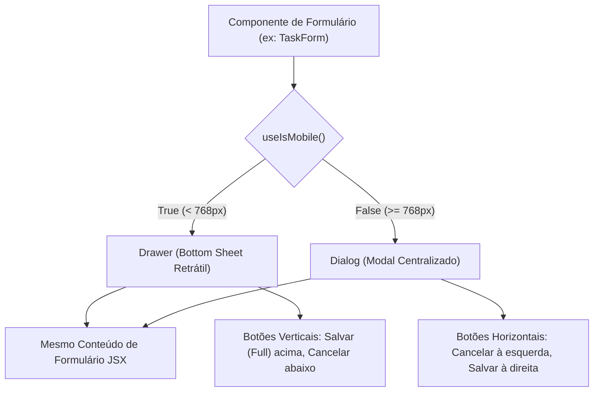

# 04. Design System, Componentes de Interface e Responsividade

Este documento formaliza a arquitetura de interface com o usuário, a composição de componentes visuais, o padrão polimórfico responsivo (Dialog vs. Drawer) e o uso do Design System construído com Tailwind CSS v4, Base UI e Boxicons.

---

## 1. Stack Visual e Design System

O Zelo adota uma das configurações mais modernas do ecossistema React:

- **Tailwind CSS v4:** Com sintaxe nativa `@import "tailwindcss";`, `@theme inline { ... }` e cores definidas no espaço cromático uniforme **OKLCH**, garantindo transições de cores perceptualmente naturais em Dark Mode e Light Mode.
- **Base UI (`@base-ui/react`):** Primitivos headless de acessibilidade (estilo `base-nova` do Shadcn) que fornecem suporte robusto a teclado, leitores de tela e gerenciamento de foco sem amarrar a camada de estilização.
- **Ícones Oficiais: Boxicons (`boxicons`):** Biblioteca primária e obrigatória de ícones, empacotada pelo componente utilitário `<BoxIcon name="..." />`.
- **Feedback Toast: Sonner (`sonner`):** Notificações flutuantes ricas (`richColors`), responsivas e acessíveis.

---

## 2. O Padrão Polimórfico: Dialog (Desktop) vs. Drawer (Mobile)

Uma das maiores forças da experiência do usuário no Zelo é o **polimorfismo de modais**: o mesmo formulário ou fluxo é renderizado como uma gaveta inferior retrátil (*bottom sheet*) no celular e como um diálogo modal centralizado no computador.



### Implementação do Padrão Polimórfico

```tsx
// Exemplo real adaptado de src/components/produtos/product-form.tsx
export function EntityForm({ open, onOpenChange, isEdit, onSubmit }: EntityFormProps) {
  const isMobile = useIsMobile();
  const [busy, setBusy] = useState(false);

  const FormContent = (
    <form onSubmit={handleSubmit} className="flex flex-col flex-1 overflow-hidden">
      <ScrollArea className="flex-1 p-4 md:p-6">
        <div className="space-y-4">
          <div className="space-y-2">
            <Label htmlFor="title">Título do Registro</Label>
            <Input id="title" required className="text-base md:text-sm" />
          </div>
          {/* Demais campos */}
        </div>
      </ScrollArea>

      {/* Ações responsivas */}
      {isMobile ? (
        <div className="shrink-0 p-4 border-t border-border flex flex-col gap-2 w-full bg-background">
          <LoadingButton type="submit" loading={busy} className="h-11 w-full rounded-full font-medium">
            Salvar
          </LoadingButton>
          <Button type="button" variant="ghost" onClick={() => onOpenChange(false)} className="h-10 w-full rounded-full text-sm">
            Cancelar
          </Button>
        </div>
      ) : (
        <div className="p-4 border-t bg-background/95 backdrop-blur-sm flex items-center justify-end gap-3 shrink-0">
          <Button type="button" variant="outline" onClick={() => onOpenChange(false)}>
            Cancelar
          </Button>
          <LoadingButton type="submit" loading={busy} className="rounded-xl h-11 px-7 text-sm font-semibold">
            Salvar
          </LoadingButton>
        </div>
      )}
    </form>
  );

  if (isMobile) {
    return (
      <Drawer open={open} onOpenChange={onOpenChange}>
        <DrawerContent className="h-[94dvh] max-h-[94dvh] p-0 flex flex-col overflow-hidden">
          <DrawerHeader className="px-4 py-3.5 border-b shrink-0 text-center">
            <DrawerTitle className="text-lg font-bold">
              {isEdit ? "Editar Registro" : "Novo Registro"}
            </DrawerTitle>
          </DrawerHeader>
          {FormContent}
        </DrawerContent>
      </Drawer>
    );
  }

  return (
    <Dialog open={open} onOpenChange={onOpenChange}>
      <DialogContent className="sm:max-w-2xl w-full max-h-[90vh] h-[90vh] p-0 flex flex-col overflow-hidden">
        <DialogHeader className="px-6 py-4 border-b shrink-0">
          <DialogTitle className="text-xl font-bold">
            {isEdit ? "Editar Registro" : "Novo Registro"}
          </DialogTitle>
        </DialogHeader>
        {FormContent}
      </DialogContent>
    </Dialog>
  );
}
```

---

## 3. Padrão de Ícones: O Componente BoxIcon

Para unificar o estilo visual e garantir ícones leves sem carregar SVGs massivos no bundle JS, o Zelo encapsula a biblioteca **Boxicons** no componente `src/components/ui/box-icon.tsx`.

### Como Usar:
```tsx
import { BoxIcon } from "@/components/ui/box-icon";

// Ícone regular padrão (linha fina)
<BoxIcon name="user" className="w-5 h-5 text-muted-foreground" />

// Ícone sólido (preenchido)
<BoxIcon name="user" solid className="w-5 h-5 text-primary" />

// Ícone de marca/logo (BXL)
<BoxIcon name="bxl-whatsapp" className="w-5 h-5 text-emerald-500" />
```

---

## 4. Tabelas de Dados e Paginação Híbrida (`@tanstack/react-table`)

A apresentação de listagens adota o padrão de **Paginação Híbrida** para atender à ergonomia de navegação mobile:

1. **No Mobile (`< 768px`):**
   - A tabela relacional é ocultada (`hidden md:block`).
   - Os dados são renderizados como uma **lista vertical de Cards touch-friendly**.
   - O `<TablePagination />` é posicionado **no topo da lista** (`md:hidden mb-3`) para que o usuário em celular não precise rolar toda a tela para mudar de página.
2. **No Desktop (`>= 768px`):**
   - Tabela tradicional com `TableHeader`, `TableRow`, `TableCell`, ordenação por clique na coluna e checkboxes de seleção múltipla.
   - O `<TablePagination />` é posicionado **no rodapé da tabela** (`hidden md:block mt-4`).

---

## 5. Botões de Ação e o MobileActionFab

- **Desktop:** Botão de ação primária localizado no cabeçalho superior da tabela/página, no formato pílula elegante (`rounded-full h-10 px-5 font-medium`).
- **Mobile:** Botão flutuante **FAB (Floating Action Button)** no canto inferior direito da tela, acima da barra de navegação (`bottom-20 right-4 md:hidden z-40`).
- **LoadingButton:** Todo botão que dispara mutações assíncronas deve usar `<LoadingButton loading={isBusy}>`, que desabilita o botão e exibe um spinner rotativo interno sem alterar a largura do componente.

---

## 6. Prevenção de Zoom Indesejado no iOS Safari

> [!IMPORTANT]
> **REGRA CRÍTICA PARA INPUTS MOBILE**
>
> O navegador Safari no iOS força zoom automático na tela quando um `<input>` ou `<textarea>` possui fonte menor que 16px.
> Para evitar esse comportamento destrutivo, **todo campo de texto DEVE utilizar a classe:**
> ```html
> className="text-base md:text-sm"
> ```
> Isso garante 16px no mobile (impedindo o zoom) e 14px nítidos no desktop.

---

## 7. Auditoria de Fidelidade: Padrões Existentes vs. Inconsistências

### Padrão Existente `[PADRÃO EXISTENTE]`
- Polimorfismo `Drawer` (mobile) e `Dialog` (desktop) amplamente implementado em todos os formulários.
- Componente `BoxIcon` com suporte inteligente a prefixos automáticos (`bx-`, `bxs-`, `bxl-`).
- Loading states consistentes com `<LoadingButton />` e `<GlobalLoader />`.

### Inconsistência Identificada `[PARCIALMENTE ADOTADO]`
- **Vazamento de ícones Lucide:** Embora `GEMINI.md` defina o uso exclusivo de Boxicons, vários componentes ainda importam ícones do `lucide-react` (ex.: `ChevronDown`, `Plus`, `Trash2` em `product-form.tsx`). Isso ocorreu devido à geração de componentes via CLI do Shadcn, cujo `components.json` estava configurado com `"iconLibrary": "lucide"`.
- **Recomendação Futura `[RECOMENDAÇÃO FUTURA]`:** Padronizar rigorosamente uma única biblioteca (preferencialmente Lucide nativo do Shadcn ou migrar 100% para Boxicons), eliminando dependências duplicadas do `package.json`.
