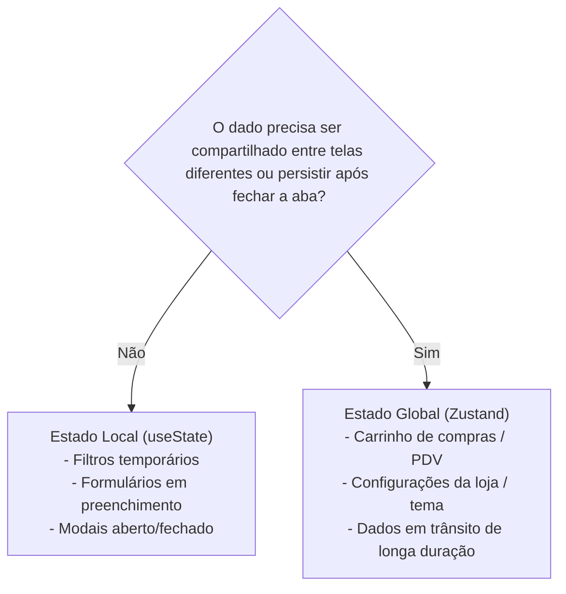
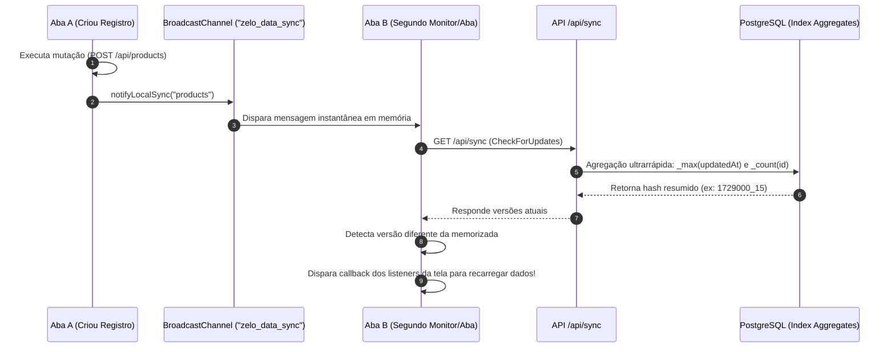

# 08. Gerenciamento de Estado, Sincronização em Tempo Real e Hooks

Este documento documenta os padrões de gerenciamento de estado com **Zustand**, as estratégias de persistência e mutações otimistas, o inovador sistema de **sincronização em tempo real multi-abas** do Zelo e os principais **Custom Hooks** do ecossistema.

---

## 1. Arquitetura de Estado: Local vs. Global

A aplicação segue uma regra clara e pragmática para alocação de estados:



- **Estado Local (`useState`):** Padrão para controlar inputs de formulários, estado de busca em tabelas, abas visíveis e alternância de visibilidade de diálogos.
- **Estado Global (`Zustand`):** Reservado para dados que atravessam múltiplas rotas (ex.: itens do carrinho de PDV) ou que exigem persistência no `localStorage`.

---

## 2. Padrões com Zustand (`src/store/`)

O Zelo adota **Zustand v5** com middlewares nativos (`persist`, `createJSONStorage`).

### A. Persistência em LocalStorage com Prevenção de Mismatch de Hidratação
Para evitar erros comuns de hidratação do Next.js quando o servidor gera HTML que difere do `localStorage` do cliente, as stores utilizam a flag `skipHydration: true` combinada com reidratação explícita no cliente:

```typescript
// src/store/useDataStore.ts
export const useDataStore = create<DataState>()(
  persist(
    (set) => ({
      items: [],
      setItems: (items) => set({ items }),
    }),
    {
      name: "app-cache-v1",
      storage: createJSONStorage(() =>
        typeof window !== "undefined" ? window.localStorage : (undefined as any)
      ),
      skipHydration: true, // Não força leitura durante a renderização do servidor
    }
  )
);

// Reidrata apenas no navegador após o carregamento inicial
if (typeof window !== "undefined") {
  void useDataStore.persist.rehydrate();
}
```

### B. Mutações Otimistas com Rollback Automático
Nas configurações da loja (`src/store/useSettingsStore.ts`), as alterações de interface refletem instantaneamente no estado local antes do retorno do servidor. Se a requisição HTTP falhar, o estado anterior é restaurado automaticamente:

```typescript
setStore: async (newStore) => {
  const previous = get().store;
  // 1. Atualização otimista imediata na interface
  set({ store: newStore });

  try {
    // 2. Persistência assíncrona no backend
    const res = await settingsService.update({ store: newStore });
    notifyLocalSync("settings");
    return res;
  } catch (error) {
    // 3. Rollback de segurança caso a API retorne erro
    set({ store: previous });
    throw error;
  }
}
```

---

## 3. O Sistema de Sincronização em Tempo Real (`useDataSync`)

Uma das inovações técnicas mais elegantes do Zelo é a sincronização instantânea de dados entre diferentes abas do navegador e entre múltiplos dispositivos, **sem a sobrecarga pesada de conexões persistentes WebSocket**.

### Arquitetura da Sincronização:
O sistema combina três pilares complementares:



### 1. Canal Local Instantâneo (`BroadcastChannel`)
- Quando o usuário cria ou edita um registro na Aba A, a função `notifyLocalSync("products")` transmite uma mensagem pelo canal `new BroadcastChannel("zelo_data_sync")`.
- A Aba B recebe o evento em **milissegundos** diretamente na memória do navegador e força uma checagem imediata, sem necessidade de recarregar a página.

### 2. Otimização de Performance no Backend (`/api/sync/route.ts`)
Para não sobrecarregar o banco de dados com queries pesadas, o endpoint de sincronização utiliza **agregações indexadas**:
```typescript
const [productAgg, clientAgg] = await Promise.all([
  prisma.product.aggregate({
    where: { lojaId },
    _max: { updatedAt: true },
    _count: { id: true },
  }),
  prisma.client.aggregate({
    where: { lojaId },
    _max: { updatedAt: true },
    _count: { id: true },
  }),
]);

return NextResponse.json({
  products: `${productAgg._max.updatedAt?.getTime() ?? 0}_${productAgg._count.id}`,
  clients: `${clientAgg._max.updatedAt?.getTime() ?? 0}_${clientAgg._count.id}`,
});
```
- Graças aos índices `@@index([lojaId, updatedAt])`, o PostgreSQL resolve essa query em **menos de 3 milissegundos**. O tráfego de rede é minúsculo (apenas timestamps e contadores).

### 3. Ciclo de Polling Eficiente com Detecção de Visibilidade
- Quando a janela está minimizada ou em segundo plano (`document.visibilityState !== "visible"`), o polling é suspenso para economizar bateria e tráfego mobile.
- Quando o usuário volta à aba (`focus` ou `visibilitychange`), uma checagem imediata é disparada.
- Se nenhuma tela ativa necessitar de sincronização, o timer é destruído (`stopSyncLoopIfEmpty()`).

---

## 4. Catálogo de Custom Hooks Reutilizáveis

| Hook | Localização | Finalidade e Comportamento |
| :--- | :--- | :--- |
| **`useIsMobile()`** | `src/hooks/use-mobile.ts` | Detecta se o viewport é menor que 768px via `window.matchMedia("(max-width: 767px)")`. Essencial para alternar entre `Drawer` e `Dialog`. |
| **`useDataSync()`** | `src/hooks/use-data-sync.ts` | Inscreve componentes para escutar alterações de entidades específicas (ex.: produtos, clientes, permissões) e disparar refetch automático. |
| **`useUserContext()`** | `src/hooks/useUserContext.ts` | Decodifica o cookie Base64 `user_context` no cliente com validação Zod e expõe o helper `hasPermission(modulo, acao)`. |
| **`useHasScrolled()`** | `src/hooks/use-has-scrolled.ts`| Monitora a rolagem vertical da janela (`scrollY > threshold`) para aplicar sombras e efeitos de blur nos cabeçalhos fixos. |

---

## 5. Auditoria de Fidelidade

- **Padrão Existente `[PADRÃO EXISTENTE]`:** Arquitetura `BroadcastChannel` + `/api/sync` com agregação indexada e detecção de visibilidade, persistência Zustand com `skipHydration`, e mutações com rollback.
- **Inconsistência Identificada `[PARCIALMENTE ADOTADO]`:** Algumas páginas implementam o refetch manualmente no `onSync`, enquanto outras chamam o serviço diretamente sem debounce, o que pode gerar requisições concorrentes em conexões instáveis.
- **Recomendação Futura `[RECOMENDAÇÃO FUTURA]`:** Integrar uma camada de data-fetching como **TanStack Query (React Query)** ou **SWR** para gerenciar o cache das requisições e deduplicação de requisições, mantendo o Zustand estritamente focado em estado de interface do cliente.
