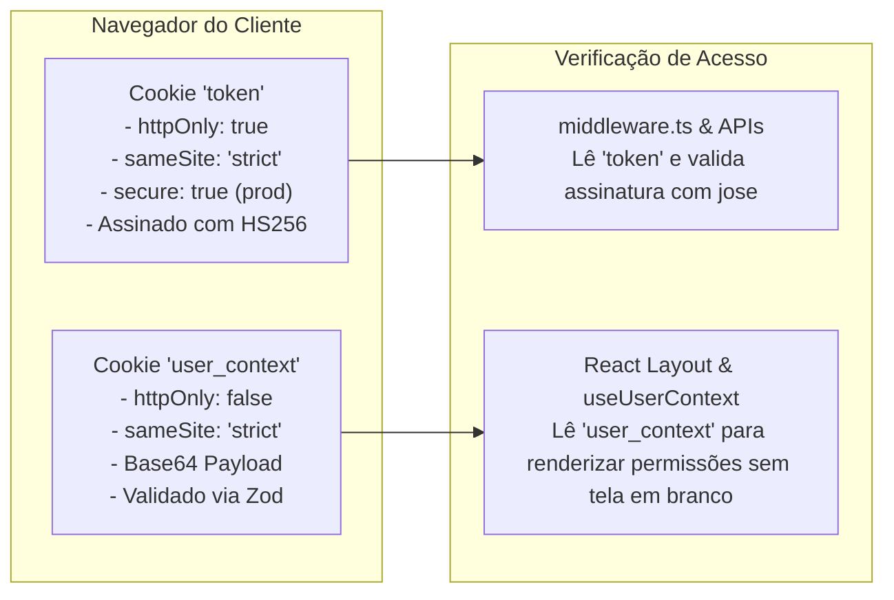

# 09. Autenticação, Autorização RBAC e Segurança

Este documento documenta a estratégia de segurança, autenticação stateless via cookies seguros, mitigação de ataques de canal lateral (timing attacks), controle de acesso granular baseado em papéis (RBAC) e cabeçalhos de proteção HTTP.

---

## 1. Estratégia de Autenticação Stateless (Dual Cookie Architecture)

Para conciliar **máxima segurança** (proteção contra XSS e roubo de sessão) com **experiência fluida** (hidratação imediata da interface sem piscamento de permissões), a arquitetura utiliza **dois cookies complementares**:



### 1. O Cookie de Segurança (`token`)
- **Configuração:** `httpOnly: true`, `sameSite: "strict"`, `secure: true` em produção, `path: "/"`, `maxAge: 8h`.
- **Conteúdo:** Token JWT criptograficamente assinado com a biblioteca `jose` usando algoritmo HS256 e chave simétrica forte (`JWT_SECRET`).
- **Segurança:** O JavaScript do navegador NÃO tem acesso a este cookie, tornando-o imune a ataques de roubo de sessão via XSS (Cross-Site Scripting). Ele é consumido exclusivamente pelo `middleware.ts` e pelas APIs do servidor.

### 2. O Cookie de Contexto Visual (`user_context`)
- **Configuração:** `httpOnly: false`, `sameSite: "strict"`, codificado em Base64.
- **Conteúdo:** Dados descritivos não-confidenciais do usuário (nome, e-mail, grupo de acesso, permissões ativas).
- **Consumo:** Lido pelo `(auth)/layout.tsx` no servidor e hidratado no cliente pelo hook `useUserContext()`.
- **Validação:** Para impedir que o usuário forje permissões manipulando o cookie local, o cliente passa os dados pelo schema Zod `userContextSchema`. Além disso, **qualquer tentativa de executar uma ação sem autorização no backend é bloqueada pela verificação do cookie `token`**.

---

## 3. Isolamento Criptográfico de Escopos (PlatformAdmin vs. Usuário Normal)

Para evitar que um token de lojista/usuário seja utilizado para acessar o painel administrativo da plataforma (ou vice-versa), os tokens carregam um claim de escopo obrigatório:

```typescript
// src/lib/jwt-auth.ts
export async function verifyAdminToken(token: string): Promise<AdminJwtPayload | null> {
  try {
    const { payload } = await jwtVerify(token, JWT_SECRET);
    // EXIGE estritamente scope === "platform"
    if (!payload.sub || payload.scope !== "platform") {
      return null;
    }
    return payload as unknown as AdminJwtPayload;
  } catch {
    return null;
  }
}
```

---

## 4. Mitigação de Ataques de Enumeração e Timing Attacks

No fluxo de autenticação (`/api/auth/login`), se o e-mail informado não existir no banco, uma comparação simples retornaria em menos de 5ms, enquanto um usuário existente executaria o cálculo pesado do `bcrypt.compare` (~100ms). Essa discrepância permitiria que atacantes descobrissem e-mails cadastrados medindo o tempo de resposta da API (*timing attack*).

### A Solução Implementada no Zelo `[PADRÃO EXISTENTE]`:
Quando o usuário não é encontrado, o backend executa uma checagem de hash fictícia contra um hash dummy pré-calculado:

```typescript
// src/app/api/auth/login/route.ts
let senhaValida = false;

if (user) {
  senhaValida = await bcrypt.compare(password, user.password);
} else {
  // Hash dummy com custo equivalente para neutralizar ataques de temporização
  await bcrypt.compare(
    password,
    "$2a$10$vI8aWBnW3fID.ZQ4/zo1G.q1lRps.9cGLcZEiGDMVr5yUP1KUOYTa"
  );
}

if (!user || !senhaValida) {
  // Mensagem genérica idêntica em ambos os casos
  return NextResponse.json({ error: "Credenciais inválidas." }, { status: 401 });
}
```

---

## 5. Autorização Granular RBAC (Role-Based Access Control)

As permissões operam no modelo matricial de **Módulo x Ação**:

- **Módulos:** `dashboard`, `produtos`, `estoque`, `nova-venda`, `clientes`, `historico`, `usuarios`, `configuracoes`.
- **Ações:** `Visualizar`, `Adicionar`, `Editar`, `Excluir`.

### A. Validação no Backend (`requirePermission`)
Toda mutação ou leitura sensível em Route Handlers invoca:

```typescript
import { requirePermission } from "@/lib/require-permission";

export async function POST(req: Request) {
  const auth = await requirePermission("produtos", "Adicionar");
  if (!auth.authorized) {
    return auth.response; // Retorna automaticamente 401 ou 403 padronizado
  }

  // Operação autorizada: auth.user contém os dados da sessão segura
}
```

### B. Renderização Condicional no Frontend (`<Can />` e `usePermissions`)
Na interface, botões de ação e abas protegidas utilizam o componente `<Can />` ou o hook `usePermissions()`:

```tsx
import { Can } from "@/components/can";
import { usePermissions } from "@/components/auth/permissions-provider";

export function ProductActions({ product }: { product: any }) {
  const { can } = usePermissions();

  return (
    <div className="flex gap-2">
      {can("produtos", "Editar") && (
        <Button onClick={handleEdit}>Editar</Button>
      )}

      <Can module="produtos" action="Excluir">
        <Button variant="destructive" onClick={handleDelete}>
          Excluir
        </Button>
      </Can>
    </div>
  );
}
```

---

## 6. Cabeçalhos de Proteção HTTP (Security Headers)

No arquivo `next.config.ts`, os seguintes cabeçalhos de segurança são injetados em todas as respostas da aplicação:

```typescript
// next.config.ts
async headers() {
  return [
    {
      source: "/(.*)",
      headers: [
        {
          key: "Content-Security-Policy",
          value: "default-src 'self'; connect-src 'self' https://*.supabase.co; script-src 'self' 'unsafe-eval' 'unsafe-inline'; style-src 'self' 'unsafe-inline'; img-src 'self' blob: data: https://*.supabase.co; font-src 'self'; object-src 'none'; base-uri 'self'; form-action 'self'; frame-ancestors 'none';"
        },
        {
          key: "Strict-Transport-Security",
          value: "max-age=63072000; includeSubDomains; preload"
        },
        {
          key: "X-Content-Type-Options",
          value: "nosniff"
        },
        {
          key: "X-Frame-Options",
          value: "DENY"
        }
      ]
    }
  ];
}
```

- **HSTS (Strict-Transport-Security):** Força conexões HTTPS durante 2 anos.
- **X-Frame-Options (DENY):** Impede que o aplicativo seja renderizado dentro de `<iframe>` por sites de terceiros, neutralizando ataques de *Clickjacking*.
- **X-Content-Type-Options (nosniff):** Impede que navegadores interpretem arquivos de mídia como scripts executáveis.

---

## 7. Auditoria de Fidelidade

- **Padrão Existente `[PADRÃO EXISTENTE]`:** Arquitetura dual cookie (`token` + `user_context`), proteção contra timing attacks com hash dummy, controle RBAC estrito no backend e cabeçalhos de segurança HTTP.
- **Inconsistência Identificada `[PARCIALMENTE ADOTADO]`:** No `GEMINI.md` o cookie era citado historicamente como `zelo_session`, enquanto o código real implementado utiliza `token` e `admin_token`.
- **Recomendação Futura `[RECOMENDAÇÃO FUTURA]`:** Centralizar o nome do cookie de autenticação em uma constante única em `src/lib/constants.ts` (ex.: `AUTH_COOKIE_NAME`), eliminando o uso de strings literais (`"token"`) espalhadas pelo código.
