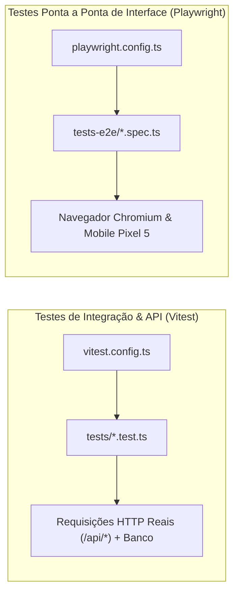

# 13. Qualidade de Código, Testes, Build e DevOps

Este documento formaliza as práticas de engenharia de software para testes automatizados, pipeline de compilação, containerização Docker multi-stage e governança de infraestrutura adotadas no projeto Zelo.

---

## 1. Ferramental de Qualidade e Análise Estática

- **TypeScript v5 (`tsconfig.json`):**
  - Configurado com `"strict": true`, `"moduleResolution": "bundler"`, `"isolatedModules": true` e `"noEmit": true`.
  - Aliases de caminho: `"@/*": ["./src/*"]`.
- **ESLint v9 (`eslint.config.mjs`):**
  - Utiliza o padrão moderno **Flat Config** com compatibilidade via `@eslint/eslintrc`.
  - Estende as regras recomendadas do Next.js: `next/core-web-vitals` e `next/typescript`.
  - Ignora pastas de build, node_modules e o diretório gerado do Prisma (`src/prisma/**`).

---

## 2. Estratégia de Testes Automatizados

O repositório adota duas ferramentas de testes complementares:



### A. Testes de Integração e APIs com Vitest (`tests/`)
- **Arquivo de Configuração:** `vitest.config.ts` com `fileParallelism: false` para evitar condições de corrida no banco de dados.
- **Funcionamento:** Os testes em `tests/*.test.ts` realizam requisições HTTP reais contra a API rodando localmente (`http://localhost:3000/api`), utilizando o helper `fetchApi` (`tests/helpers.ts`).
- **O que é testado:**
  - Isolamento de tenants (`multi-tenant.test.ts`).
  - Restrições e permissões de perfis de usuário (`rbac.test.ts`).
  - Lógica de movimentação atômica de estoque (`stock-movements.test.ts`).
  - Validação de regras de negócio em vendas (`sales.test.ts`).
  - Validação de schemas e duplicidades de chaves (`import-validation.test.ts`).

### B. Testes Ponta a Ponta no Navegador com Playwright (`tests-e2e/`)
- **Arquivo de Configuração:** `playwright.config.ts`.
- **Funcionamento:** Inicializa o servidor web automaticamente (`command: 'pnpm dev'`) e simula interações completas de usuários reais em navegadores reais.
- **Matriz de Dispositivos:**
  - **Desktop Chrome:** Validação de telas em alta resolução e menus laterais.
  - **Mobile Chrome (Pixel 5 emulado):** Validação de drawers inferiores, gestos touch, alvos de toque e barra de navegação inferior.

---

## 3. Pipeline de Compilação e Standalone Build

No arquivo `next.config.ts`, a geração do artefato de produção utiliza a compilação **Standalone**:

```typescript
const nextConfig: NextConfig = {
  output: process.env.DOCKER_BUILD === "1" ? "standalone" : undefined,
  // ...
};
```

### Por que o Standalone Build é Crucial?
Em aplicações Next.js convencionais, o deploy exige a pasta inteira `node_modules` (frequentemente com mais de 1.2 GB).
Com `output: "standalone"`:
1. O Next.js analisa a árvore de código e copia **estritamente os módulos utilizados** para `.next/standalone`.
2. A imagem final do Docker passa a pesar **menos de 200 MB**.
3. O servidor sobe via comando direto e ultra-leve `node server.js`, sem depender de Next CLI ou pnpm em produção.

---

## 4. Containerização: Dockerfile Multi-Stage de Produção

O `Dockerfile` é estruturado em 4 estágios independentes para maximizar o cache de camadas e reforçar a segurança:

```dockerfile
# 1. Base Image: Node 20 no Alpine Linux
FROM node:20-alpine AS base
WORKDIR /app
RUN apk add --no-cache libc6-compat openssl
RUN npm install -g pnpm@latest

# 2. Dependencies Stage: Cache das dependências
FROM base AS deps
WORKDIR /app
RUN apk add --no-cache python3 make g++
COPY package.json pnpm-lock.yaml ./
COPY prisma ./prisma
RUN pnpm install --frozen-lockfile

# 3. Builder Stage: Geração Prisma e Build Standalone
FROM base AS builder
WORKDIR /app
COPY --from=deps /app/node_modules ./node_modules
COPY . .
ENV NEXT_TELEMETRY_DISABLED=1
ENV NODE_ENV=production
ENV DOCKER_BUILD=1
RUN npx prisma generate
RUN pnpm build

# 4. Runner Stage: Imagem mínima não-root
FROM node:20-alpine AS runner
WORKDIR /app
ENV NODE_ENV=production
ENV PORT=3000
ENV HOSTNAME="0.0.0.0"
RUN apk add --no-cache libc6-compat openssl curl

# Segurança: Executa como usuário não-root (UID 1001)
RUN addgroup --system --gid 1001 nodejs && \
    adduser --system --uid 1001 nextjs

COPY --from=builder /app/public ./public
COPY --from=builder --chown=nextjs:nodejs /app/.next/standalone ./
COPY --from=builder --chown=nextjs:nodejs /app/.next/static ./.next/static

USER nextjs
EXPOSE 3000

HEALTHCHECK --interval=30s --timeout=5s --start-period=10s --retries=3 \
  CMD curl -f http://localhost:3000/api/sync || exit 1

CMD ["node", "server.js"]
```

---

## 5. Orquestração Local com Docker Compose

O arquivo `docker-compose.yml` sobe a stack completa com apenas um comando:

```bash
docker compose up -d
```

### Serviços Configurados:
1. **`db` (Postgres 16 Alpine):**
   - Porta 5432 exposta.
   - Volume nomeado persistente `zelo_postgres_data`.
   - Healthcheck ativo com `pg_isready`.
2. **`app` (Aplicação Next.js):**
   - Porta 3000 exposta.
   - Aguarda a saúde do banco (`condition: service_healthy`) antes de iniciar.
   - Rede interna isolada (`zelo-network`).

---

## 6. Governança de Scripts no `package.json`

| Script | Comando Executado | Finalidade |
| :--- | :--- | :--- |
| `pnpm dev` | `next dev` | Inicia servidor de desenvolvimento com hot-reload |
| `pnpm build` | `npx prisma generate && next build` | Gera o cliente Prisma e compila o bundle de produção |
| `pnpm start` | `next start` | Inicia o servidor Next compilado (fora do Docker) |
| `pnpm lint` | `eslint` | Executa análise estática de qualidade de código |
| `pnpm test:e2e`| `vitest run` | Executa a suíte de testes de integração e APIs |

---

## 7. Auditoria de Fidelidade

- **Padrão Existente `[PADRÃO EXISTENTE]`:** Dockerfile multi-stage com compilação standalone, Docker Compose com PostgreSQL e healthchecks, suíte robusta de testes de integração com Vitest.
- **Inconsistência Identificada `[PARCIALMENTE ADOTADO]`:**
  - O script `"test:e2e"` no `package.json` aponta para `vitest run` (testes de API em `tests/`), enquanto os testes reais de navegador Playwright residem em `tests-e2e/`, sem um script dedicado configurado no `package.json`.
- **Recomendação Futura `[RECOMENDAÇÃO FUTURA]`:** Padronizar os scripts no `package.json`:
  ```json
  "test:unit": "vitest run",
  "test:e2e": "playwright test",
  "test": "pnpm test:unit && pnpm test:e2e"
  ```
