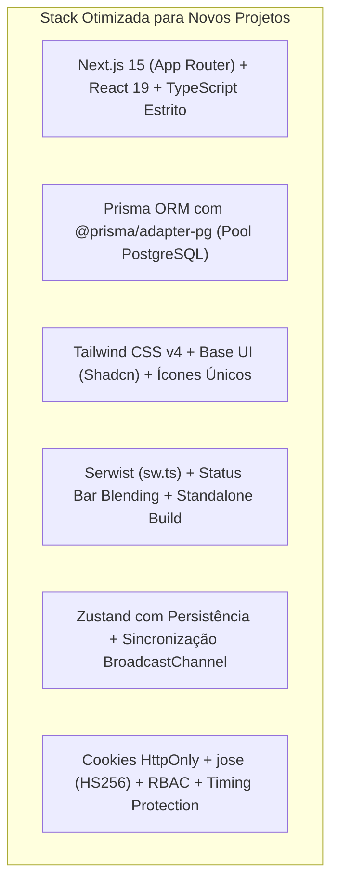

# 14. Débitos Técnicos, Inconsistências e Recomendações para Novos Projetos

Este documento sintetiza de forma transparente e crítica todas as inconsistências, duplicidades e débitos técnicos identificados durante a auditoria minuciosa do código-fonte do Zelo. Adicionalmente, apresenta a **matriz de recomendações arquiteturais** para garantir que novos projetos herdem as forças de engenharia do Zelo sem replicar seus pontos de atrito.

---

## 1. Inventário de Débitos Técnicos e Inconsistências no Zelo

Durante a análise direta de arquivos, schemas, configurações e implementações reais, foram identificados os seguintes débitos:

### 1. Dependência Órfã no `package.json`
- **Diagnóstico:** O arquivo `package.json` lista `@hookform/resolvers: ^5.7.1`, porém a biblioteca principal `react-hook-form` **não está instalada** e não há nenhuma chamada a `useForm` em todo o código-fonte. Os formulários são controlados via `useState`.
- **Impacto:** Dependência morta no projeto, gerando ruído e aumentando o tempo de instalação.

### 2. Duplicação de Bibliotecas de Criptografia JWT
- **Diagnóstico:** Coexistem no projeto as dependências `jose` e `jsonwebtoken`. O middleware e as rotas seguras utilizam a biblioteca moderna `jose` (compatível com padrões Web Crypto), tornando `jsonwebtoken` redundante.
- **Impacto:** Dependência desnecessária no bundle de servidor.

### 3. Duplicação de Bibliotecas de Hashing de Senhas
- **Diagnóstico:** O projeto possui tanto `bcrypt` quanto `bcryptjs`. O `bcrypt` requer ferramentas de compilação em C++ (`python3`, `make`, `g++`) no Dockerfile, enquanto o `bcryptjs` é 100% JavaScript puro e multiplataforma.
- **Impacto:** Aumenta o tempo de build do container Docker e adiciona complexidade à imagem base Alpine.

### 4. Duplicação de Conjuntos de Ícones (Boxicons vs. Lucide)
- **Diagnóstico:** O guia de design e as regras de engenharia estabelecem o uso exclusivo do componente `<BoxIcon name="..." />`. No entanto, componentes gerados pelo CLI do Shadcn importam ícones do `lucide-react` (ex.: `ChevronDown`, `Plus`, `Trash2` em `product-form.tsx`).
- **Impacto:** Carregamento de dois pacotes de ícones distintos na mesma aplicação, gerando pequenas inconsistências de espessura de traço na interface.

### 5. Scripts Residuais e Arquivos de Backup na Raiz
- **Diagnóstico:** Foram encontrados na raiz do projeto e em pastas internas scripts temporários de migração e cópias manuais de arquivos:
  - `transform.js`, `transform-clean.js`, `transform-dash.js`, `transform-import-clients.js`, etc.
  - `prisma/schema.prisma.bak`, `prisma/schema.prisma.with_variants`
  - `old_page.tsx` (ignorado manualmente no `tsconfig.json`).
- **Impacto:** Poluição da raiz do repositório e risco de confusão para novos desenvolvedores ou agentes de IA.

### 6. Desativação da Regra `no-explicit-any` no ESLint
- **Diagnóstico:** O arquivo `eslint.config.mjs` desativa explicitamente `"@typescript-eslint/no-explicit-any": "off"`. Constatou-se o uso frequente de `(objeto as any)` para contornar tipagens do Prisma e de respostas de serviços.
- **Impacto:** Perda de garantias do compilador TypeScript em tempo de compilação, permitindo que alterações de schema gerem erros silenciosos em runtime.

### 7. Divergência na Nomenclatura de Cookies Documentada
- **Diagnóstico:** No arquivo de diretrizes anterior (`GEMINI.md`), o cookie de sessão era citado como `zelo_session`. Na implementação real do código (`src/lib/cookies.ts`, `middleware.ts`, `src/lib/auth.ts`), os cookies utilizados são estritamente `token` e `admin_token`.
- **Impacto:** Risco de desalinhamento conceitual se o time consultar apenas a documentação textual antiga.

### 8. Ambiguidade nos Scripts de Teste
- **Diagnóstico:** No `package.json`, o script `"test:e2e"` executa `vitest run` (que roda os testes de API em `tests/`), enquanto a suíte real de testes E2E com navegador Playwright fica em `tests-e2e/`, sem um script dedicado no manifesto.
- **Impacto:** Ambiguidade entre testes de integração de API e testes ponta a ponta no navegador.

### 9. Duplicação de Definições de Tipos
- **Diagnóstico:** As definições de tipos para controle de acesso (`ModuleKey`, `ActionKey`, `Permissions`, `AccessGroup`) estão duplicadas literalmente em `src/types/permissions.ts` e em `src/store/useSettingsStore.ts`.
- **Impacto:** Risco de divergência caso uma nova permissão seja adicionada em um arquivo e esquecida no outro.

### 10. Background Jobs via `setImmediate`
- **Diagnóstico:** O processamento em segundo plano de catálogos e IA utiliza `setImmediate()` dentro de Route Handlers. Isso funciona perfeitamente no container Docker Node.js standalone do Zelo, mas quebraria em ambientes Serverless puros como Vercel Functions.
- **Impacto:** Acoplamento da lógica de background ao modelo de hospedagem com servidor Node persistente.

---

## 2. Matriz de Recomendações Arquiteturais para Novos Projetos

Para garantir a máxima longevidade, manutenibilidade e facilidade de suporte por agentes de IA nos próximos projetos, adote as seguintes decisões consolidadas:

| Pilar Arquitetural | O Que Manter do Zelo (Sucessos) | O Que Mudar no Novo Projeto (Melhorias) |
| :--- | :--- | :--- |
| **Gerenciador** | Uso mandatório do **`pnpm`**. | Manter estritamente sem exceções. |
| **Arquitetura de APIs** | Route Handlers REST com status corretos, validação Zod e serialização de `Decimal`. | Criar helpers genéricos para CRUD para reduzir código repetitivo em rotas simples. |
| **Banco de Dados** | Padrão de soft delete com sufixo temporal (`_del_${Date.now()}`) para liberar chaves únicas. | Automatizar o soft delete via Prisma Client Extensions para não depender de queries manuais. |
| **Autenticação** | Arquitetura de dois cookies: `token` (HttpOnly seguro) e `user_context` (Base64 para UI). | Centralizar nomes de cookies em constantes e utilizar exclusivamente `jose` e `bcryptjs`. |
| **Design System** | Padrão polimórfico `Drawer` (mobile) e `Dialog` (desktop) com classes `text-base md:text-sm`. | Escolher **uma única** biblioteca de ícones (ou 100% Boxicons ou 100% Lucide) e expurgar a outra. |
| **Formulários** | Validação centralizada em `src/lib/validations/` com `z.preprocess` para vazios. | Para telas com muitos campos, adotar formalmente `react-hook-form` + `@hookform/resolvers/zod`. |
| **Tipagem** | Modelos fortemente tipados pelo Prisma. | Manter `@typescript-eslint/no-explicit-any: "error"` e tipar colunas JSON via Zod schemas. |
| **Sincronização** | Hook `useDataSync` com agregação indexada (`/api/sync`) e canal local `BroadcastChannel`. | Manter exatamente como projetado; é um dos maiores trunfos de performance do Zelo. |
| **DevOps** | Dockerfile multi-stage com compilação standalone e usuário não-root. | Adicionar etapa de migração automática no entrypoint do container. |
| **Testes** | Uso de Vitest para APIs e Playwright para mobile. | Padronizar scripts: `"test:int": "vitest run"` e `"test:e2e": "playwright test"`. |

---

## 3. Diretrizes de Governança para Manutenção por IA

1. **Repositório Limpo:** Scripts pontuais de migração, limpeza de dados ou correções devem ser criados na pasta `scripts/` e excluídos ou arquivados após a conclusão da tarefa.
2. **Atualização Documental Contínua:** Sempre que uma decisão arquitetural for refinada (ex.: adição de um novo hook global ou troca de um provedor de storage), este guia deve ser atualizado imediatamente.
