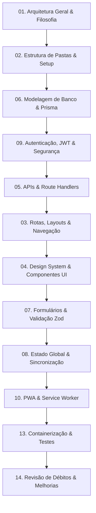

# Guia de Padrões Arquiteturais e de Engenharia - Zelo Reference

Este repositório documental reúne, de forma aprofundada, pragmática e desacoplada de regras de negócio, todos os padrões arquiteturais, decisões de engenharia de software, modelos de dados, segurança, interfaces e DevOps consolidados no desenvolvimento do ecossistema **Zelo**.

O propósito deste material é servir como **referência técnica canônica e reutilizável** para a concepção e implementação de novos sistemas web modernos construídos sobre **Next.js (App Router)** e distribuídos com experiência nativa como **Progressive Web Apps (PWA)** — tais como aplicativos de gestão financeira, gerenciamento de tarefas, plataformas administrativas, ERPs leves e ferramentas corporativas.

---

## 1. Princípios de Fidelidade e Governança

Para assegurar total transparência e utilidade técnica, todo o conteúdo desta documentação obedece a uma classificação estrita em três níveis de fidelidade:

| Nível de Fidelidade | Identificador Visual | Definição Operacional |
| :--- | :---: | :--- |
| **Padrão Existente** | `[PADRÃO EXISTENTE]` | Arquitetura, biblioteca ou padrão de código **efetivamente implementado, testado e ativo** no repositório do Zelo. |
| **Padrão Parcialmente Adotado** | `[PARCIALMENTE ADOTADO]` | Padrão que aparece em partes do sistema, mas possui variações, débitos técnicos ou falta de consistência em outros módulos. |
| **Recomendação Futura** | `[RECOMENDAÇÃO FUTURA]` | Abordagem otimizada recomendada para novos projetos a fim de evitar limitações ou débitos identificados no Zelo. **Nunca** é apresentada como código existente. |

---

## 2. Matriz de Documentos

A documentação está distribuída em 15 arquivos Markdown modulares e especializados, localizados em `docs/project-standards/`:

```text
docs/project-standards/
├── README.md                                 # Guia mestre, visão geral e mapa de navegação
├── ai-agent-instructions.md                  # Protocolo de execução e diretrizes para Agentes de IA
├── 01-arquitetura-geral.md                   # Macroarquitetura, Next.js App Router e Server/Client Components
├── 02-estrutura-de-pastas.md                 # Organização de diretórios e template de referência para novos projetos
├── 03-paginas-layouts-navegacao.md           # Route Groups, layouts híbridos, proteção e navegação mobile/desktop
├── 04-componentes-e-interface.md             # Design system, Base UI, Tailwind v4, Boxicons e componentes polimórficos
├── 05-backend-e-apis.md                      # Route Handlers, validação Zod, auditoria, rate limit e background jobs
├── 06-banco-de-dados-e-orm.md                # Prisma ORM, adapter-pg, concorrência, transações e soft delete com sufixo
├── 07-formularios-e-validacao.md             # Formulários controlados, Zod preprocessing, máscaras brasileiras e validações
├── 08-gerenciamento-de-estado-e-hooks.md     # Zustand com persistência, sincronização em tempo real (Broadcast + /api/sync)
├── 09-autenticacao-autorizacao-seguranca.md  # Cookies HttpOnly/contexto, JWT stateless, RBAC granular e headers de segurança
├── 10-pwa-e-offline.md                       # Serwist, runtime caching, sincronização de status bar e experiência instalável
├── 11-catalogo-de-dependencias.md            # Auditoria técnica de todas as dependências, criticidade e alternativas
├── 12-convencoes-de-codigo-e-estilo.md       # Nomenclaturas, TypeScript estrito, organização de imports e tipagem de dados
├── 13-qualidade-testes-e-devops.md           # Vitest, Playwright, Dockerfile multi-stage, Docker Compose e CI/CD
└── 14-debitos-tecnicos-e-recomendacoes.md    # Auditoria de débitos técnicos, discrepâncias e plano de evolução
```

---

## 3. Classificação: Documentos Essenciais vs. Opcionais

Ao iniciar um novo projeto utilizando esta base arquitetural, consulte os documentos de acordo com a natureza do sistema:

### Documentos Essenciais (Obrigatórios para qualquer projeto)
1. **`01-arquitetura-geral.md`**: Estabelece o modelo mental Server vs. Client Components e o fluxo de dados.
2. **`02-estrutura-de-pastas.md`**: Define a árvore de diretórios padrão e onde posicionar cada artefato.
3. **`05-backend-e-apis.md`**: Padroniza a resposta HTTP, validação de payload com Zod e tratamento de erros.
4. **`06-banco-de-dados-e-orm.md`**: Define o acesso a banco de dados com Prisma, connection pooling e segurança de concorrência.
5. **`07-formularios-e-validacao.md`**: Padroniza entradas de dados, tratamento de nulos/vazios e máscaras.
6. **`09-autenticacao-autorizacao-seguranca.md`**: Estabelece cookies seguros, assinatura de tokens JWT e guardas RBAC.
7. **`12-convencoes-de-codigo-e-estilo.md`**: Garante uniformidade de código, nomenclatura de arquivos e imports.

### Documentos Condicionais / Opcionais (Conforme a demanda do produto)
- **`08-gerenciamento-de-estado-e-hooks.md`**: Essencial para aplicações interativas (carrinhos, fluxos multi-step, sincronização entre abas); simplificável caso o sistema seja primariamente server-rendered com mutações diretas.
- **`10-pwa-e-offline.md`**: Mandatório se o objetivo for uma experiência instalável em dispositivos móveis (Add to Home Screen / offline parcial); dispensável para portais administrativos exclusivamente desktop.
- **`04-componentes-e-interface.md`**: Focado no ecossistema Base UI + Shadcn + Tailwind CSS v4 + Boxicons. Se o projeto adotar outro design system, serve como referência para os padrões polimórficos (Dialog/Drawer).
- **`13-qualidade-testes-e-devops.md`**: Focado na containerização (Docker Multi-stage) e testes automatizados (Vitest/Playwright).

---

## 4. Ordem Recomendada de Leitura e Implantação

Para engenheiros ou agentes autônomos iniciando um novo projeto a partir do zero, recomenda-se a seguinte sequência lógica:



1. **Fundação Arquitetural:** `01-arquitetura-geral.md` e `02-estrutura-de-pastas.md`.
2. **Camada de Dados & Segurança:** `06-banco-de-dados-e-orm.md` e `09-autenticacao-autorizacao-seguranca.md`.
3. **Comunicação & APIs:** `05-backend-e-apis.md`.
4. **Navegação & UI:** `03-paginas-layouts-navegacao.md` e `04-componentes-e-interface.md`.
5. **Formulários & Estado:** `07-formularios-e-validacao.md` e `08-gerenciamento-de-estado-e-hooks.md`.
6. **Mobile Experience:** `10-pwa-e-offline.md`.
7. **Homologação e Deploy:** `13-qualidade-testes-e-devops.md` e `14-debitos-tecnicos-e-recomendacoes.md`.

---

## 5. Como Utilizar Esta Documentação em Novos Projetos

1. **Copie as referências técnicas, não os nomes do domínio:** Ao criar um aplicativo de tarefas ou finanças, substitua entidades específicas (ex.: `Loja`, `Product`, `Sale`) pelas suas entidades correspondentes (ex.: `Workspace`, `Transaction`, `Account`), preservando a arquitetura multi-tenant, os mecanismos de soft delete com sufixo único, e a separação em camadas.
2. **Consulte `ai-agent-instructions.md`:** Se o desenvolvimento for conduzido ou auxiliado por agentes de inteligência artificial, este arquivo deve ser injetado no contexto operacional como regra mandatória de engenharia.
3. **Consulte `14-debitos-tecnicos-e-recomendacoes.md`:** Antes de reproduzir qualquer código ou dependência, certifique-se de que a implementação não contém débitos já identificados no Zelo que possam ser solucionados preventivamente no novo software.
