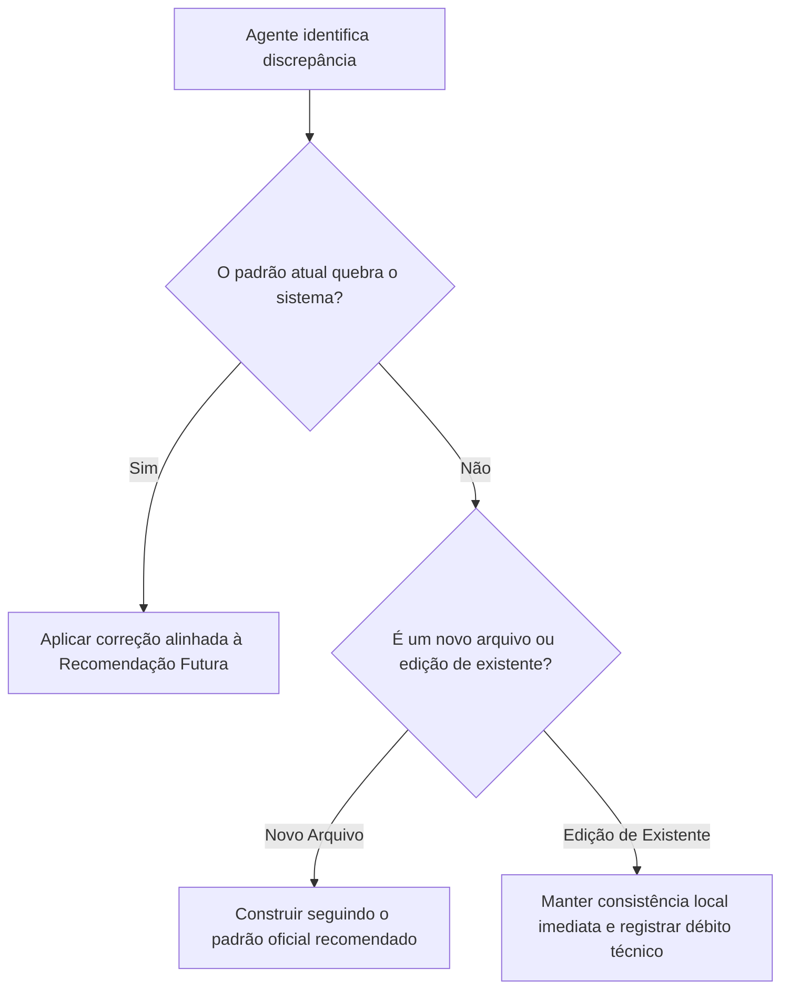

# Instruções e Protocolo Operacional para Agentes de IA

Este documento estabelece o protocolo de comportamento, verificação prévia e padrões de código que **TODO AGENTE DE INTELIGÊNCIA ARTIFICIAL** deve seguir estritamente ao atuar no desenvolvimento, refatoração ou manutenção de sistemas baseados na arquitetura de referência Zelo.

---

## 1. Princípios Inegociáveis para Agentes

Ao receber uma tarefa em um projeto que adota estes padrões, o agente deve operar sob as seguintes diretrizes fundamentais:

> [!IMPORTANT]
> **REGRAS DE CONDUTA OPERACIONAL**
> 1. **Consulte antes de codificar:** Antes de criar arquivos, rotas ou componentes, leia o documento correspondente em `docs/project-standards/`.
> 2. **Não invente novas arquiteturas:** Reutilize as camadas e padrões já homologados. Nunca introduza bibliotecas redundantes (ex.: adicionar `axios` quando já existe `fetch/apiRequest`, ou `react-router` dentro do Next.js App Router).
> 3. **Respeite o nível de fidelidade:** Distinga categoricamente entre o que é um `[PADRÃO EXISTENTE]`, um `[PARCIALMENTE ADOTADO]` e uma `[RECOMENDAÇÃO FUTURA]`. Nunca implemente uma recomendação assumindo que o código atual já a possui sem verificar.
> 4. **Desacoplamento de domínio:** Adapte os padrões ao domínio do novo projeto (ex.: financeiro, tarefas, CRM). Não copie nomes de tabelas ou regras de negócio do Zelo a menos que o projeto atual demande expressamente.
> 5. **Preservação de integridade:** Em refatorações, nunca quebre testes existentes nem apague regras de integridade relacional ou autenticação.

---

## 2. Checklist Pré-Implementação por Tipo de Tarefa

Antes de iniciar qualquer intervenção, execute a lista de checagem correspondente:

### A. Ao criar um novo Endpoint de API (Route Handler)
- [ ] Ler `05-backend-e-apis.md` e `09-autenticacao-autorizacao-seguranca.md`.
- [ ] O arquivo está localizado em `src/app/api/<entidade>/route.ts` ou `src/app/api/<entidade>/[id]/route.ts`?
- [ ] O endpoint verifica autenticação e autorização RBAC via `requirePermission(modulo, acao)` no início do handler?
- [ ] Toda query ao banco de dados está filtrada pelo identificador do tenant (`lojaId` / `tenantId`) e `deletedAt: null`?
- [ ] O payload foi validado via Zod (`schema.safeParse` ou `schema.parse`) antes de qualquer operação de escrita?
- [ ] Valores decimais do Prisma foram serializados (`Number(valor)`) antes do retorno JSON?
- [ ] Operações com alteração de estado auditável disparam registro em log de auditoria?
- [ ] Em Next.js 15+, a propriedade `params` foi consumida de forma assíncrona (`const { id } = await params;`)?

### B. Ao criar uma nova Tela ou Página
- [ ] Ler `03-paginas-layouts-navegacao.md` e `04-componentes-e-interface.md`.
- [ ] A página está sob o Route Group apropriado (ex.: `(auth)` para privada, `(admin)` para administrativa, pública para login/registro)?
- [ ] O container principal possui a classe de compensação mobile: `pb-24 md:pb-6`?
- [ ] Se a página for Client Component (`"use client"`), os dados são consumidos via camada de serviço (`src/services/`) ou hook de sincronização?
- [ ] Os estados de `loading` (Skeleton/Spinner), erro (Sonner Toast) e lista vazia (Empty State com ícone Boxicon) estão tratados?
- [ ] Existe botão de ação em cabeçalho para desktop e `MobileActionFab` flutuante para mobile?

### C. Ao criar um Formulário ou Modal
- [ ] Ler `04-componentes-e-interface.md` e `07-formularios-e-validacao.md`.
- [ ] O componente adota o padrão polimórfico: `Drawer` em telas móveis (`useIsMobile`) e `Dialog` em telas desktop?
- [ ] Os campos de input possuem `text-base md:text-sm` para evitar zoom indesejado no iOS Safari?
- [ ] O fechamento acidental de formulários em preenchimento está bloqueado?
- [ ] Entradas opcionais de texto toleram strings vazias no Zod com `.or(z.literal("")).nullable().optional()`?
- [ ] Campos numéricos utilizam `z.preprocess` para tratar strings vazias sem falhar na coerção numérica?
- [ ] Máscaras de telefone, CPF/CNPJ e CEP usam as funções de `src/lib/masks.ts`?

### D. Ao criar ou alterar Tabelas e Migrations no Prisma
- [ ] Ler `06-banco-de-dados-e-orm.md`.
- [ ] A nova tabela possui a chave estrangeira obrigatória do tenant (`lojaId` ou equivalente) com índice `@@index([tenantId])`?
- [ ] Possui colunas de auditoria temporal (`createdAt`, `updatedAt`, `deletedAt`)?
- [ ] Índices únicos compostos que suportam soft delete utilizam o padrão de liberação de chave por sufixo timestamp (`_del_${timestamp}`)?
- [ ] `generator client` mantém o output centralizado (`../src/prisma`) e `binaryTargets = ["native", "linux-musl-openssl-3.0.x"]`?

---

## 3. Protocolo de Resolução de Inconsistências

Caso o agente encontre um padrão divergente no código do projeto atual em relação a esta documentação:

1. **Nunca force uma refatoração em massa** não solicitada pelo usuário que possa gerar efeitos colaterais.
2. Ao criar código novo, adote o **padrão correto** documentado.
3. Se o padrão arquitetural for evoluído intencionalmente durante uma tarefa, atualize o documento correspondente em `docs/project-standards/` e o histórico em `14-debitos-tecnicos-e-recomendacoes.md`.

---

## 4. Gerenciamento de Pacotes e Scripts

> [!CAUTION]
> **GERENCIADOR MANDATÓRIO: `pnpm`**
>
> - **NUNCA** execute `npm install`, `npm run`, `yarn` ou `bun` neste repositório.
> - **SEMPRE** utilize `pnpm add <pacote>`, `pnpm add -D <pacote>`, `pnpm dev`, `pnpm build`, `pnpm lint`.
> - Utilize `pnpm dlx` ou `npx` estritamente quando se tratar de comandos CLI pontuais (ex.: `npx prisma generate`).

---

## 5. Convenção de Respostas ao Usuário

Ao concluir implementações para o usuário:
- Indique com clareza quais arquivos foram criados ou editados utilizando links relativos navegáveis.
- Destaque quais decisões seguiram os padrões de `docs/project-standards/`.
- Sinalize eventuais decisões que divergiram do padrão em razão de restrições pontuais.
